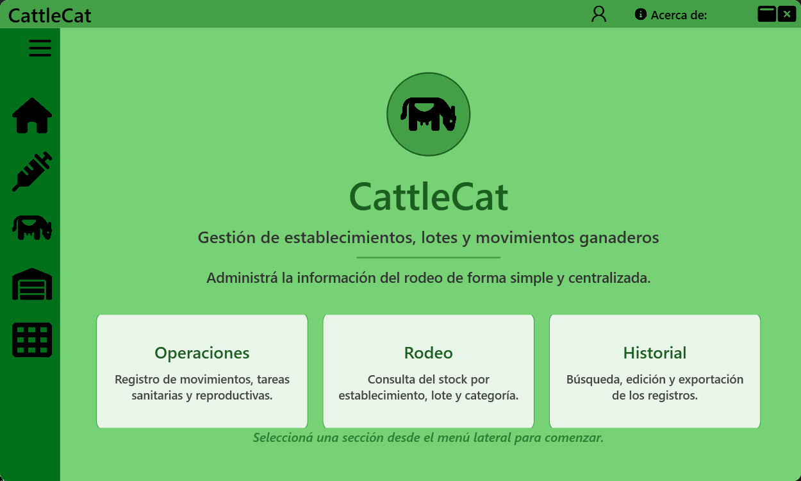
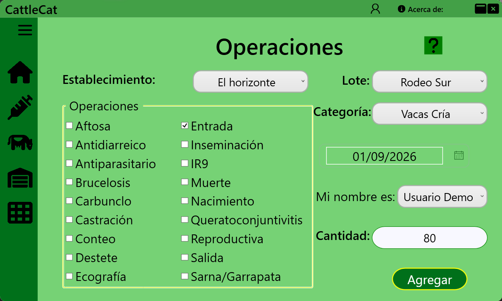
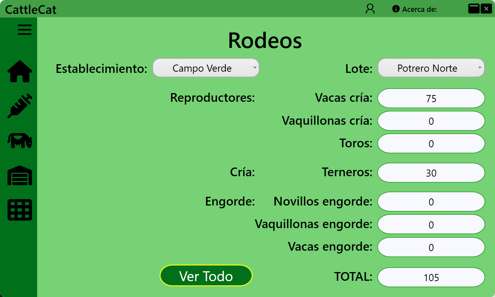
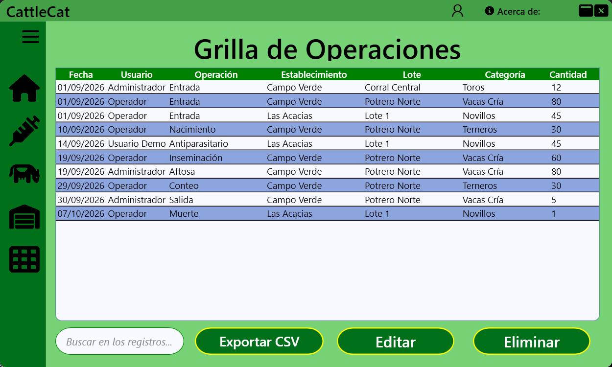
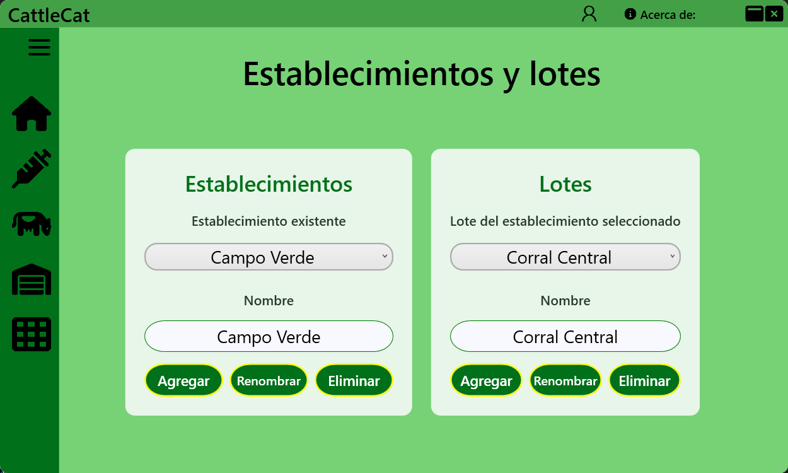
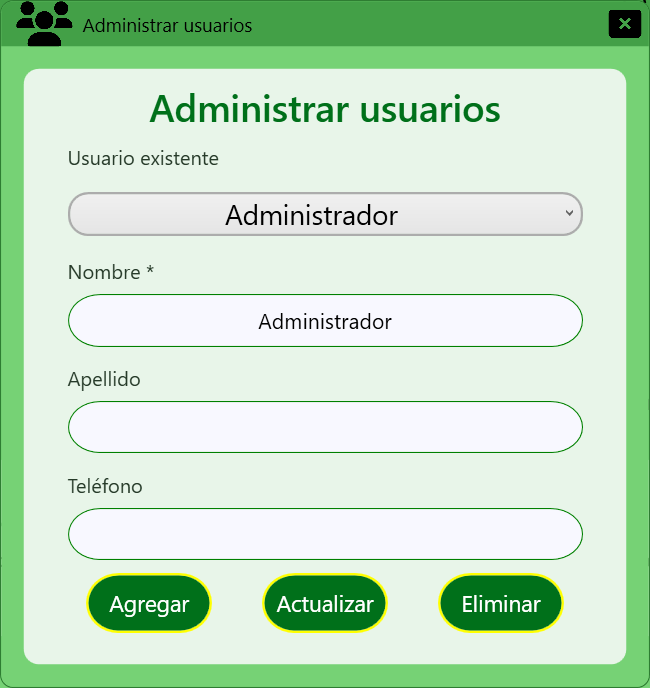
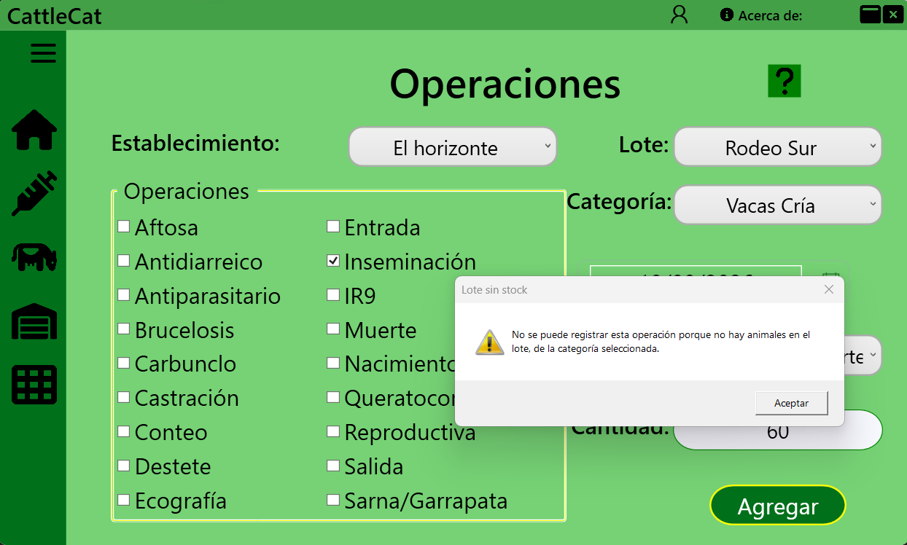

# CattleCat

Sistema de escritorio para la gestión de rodeos y operaciones ganaderas, desarrollado con C#, WPF, Entity Framework 6 y SQL Server.

CattleCat permite administrar establecimientos y lotes, registrar movimientos y tareas sanitarias, consultar la composición del rodeo y conservar un historial de operaciones. El proyecto combina conocimientos de gestión ganadera con una arquitectura de software por capas.

## Funcionalidades

- Registro de operaciones ganaderas y sanitarias.
- Consulta del rodeo total y por categoría.
- Filtrado de lotes según el establecimiento seleccionado.
- Alta, modificación y desactivación lógica de establecimientos y lotes.
- Alta, modificación y desactivación lógica de usuarios.
- Edición y eliminación lógica de registros.
- Búsqueda incremental en el historial de operaciones.
- Exportación de la grilla a CSV.
- Validación de stock antes de registrar o modificar movimientos.
- Conservación del historial asociado a entidades desactivadas.

## Operaciones contempladas

Entre otras, la aplicación permite registrar:

- Entrada
- Salida
- Nacimiento
- Muerte
- Conteo
- Aftosa
- Antiparasitario
- Brucelosis
- Castración
- Destete
- Ecografía
- Inseminación
- IR9
- Reproductiva
- Queratoconjuntivitis
- Sarna/Garrapata

## Reglas de stock

El stock se calcula cronológicamente por establecimiento, lote y categoría:

```text
Stock = Entradas + Nacimientos - Salidas - Muertes
```

La aplicación impide operaciones que producirían stock negativo. Esta validación también se aplica al editar o eliminar registros históricos, porque una modificación anterior puede afectar el stock disponible en fechas posteriores.

Las eliminaciones de registros, usuarios, establecimientos y lotes son lógicas. De esta manera se preserva la trazabilidad del historial.

## Tecnologías

- C#
- WPF
- .NET Framework 4.7.2
- Entity Framework 6
- LINQ
- SQL Server / SQL Server Express
- XAML
- Arquitectura por capas

## Arquitectura

La solución separa responsabilidades en proyectos o capas:

- **Presentation:** interfaz de usuario WPF, ventanas, controles y estilos XAML.
- **Logic:** reglas de negocio y validaciones.
- **Dalc:** acceso y persistencia de datos.
- **Entities:** modelo de entidades y contexto de Entity Framework.

## Requisitos

- Windows 10 o superior.
- Visual Studio 2022 con la carga de trabajo **Desarrollo de escritorio de .NET**.
- .NET Framework 4.7.2 Developer Pack.
- SQL Server Express o SQL Server.
- SQL Server Management Studio, recomendado para administrar la base de datos.

## Configuración de la base de datos

La configuración predeterminada espera una instancia local de SQL Server Express y utiliza autenticación integrada de Windows:

```xml
<add name="ModelConfig"
     connectionString="data source=.\SQLEXPRESS;initial catalog=FarmDB;integrated security=True;MultipleActiveResultSets=True;App=EntityFramework"
     providerName="System.Data.SqlClient" />
```

La cadena debe estar presente en los archivos `App.config` correspondientes. No contiene usuario ni contraseña: SQL Server autentica la cuenta actual de Windows.

Si la instancia posee otro nombre, sustituya `.\SQLEXPRESS` por el nombre correspondiente antes de iniciar la aplicación.

## Ejecución local

1. Clonar el repositorio:

   ```bash
   git clone https://github.com/juanignacio87/CattleCat.git
   ```

2. Abrir la solución en Visual Studio.
3. Restaurar los paquetes NuGet.
4. Verificar la cadena de conexión de `ModelConfig`.
5. Crear o restaurar la base de datos `FarmDB` y aplicar las migraciones o el script SQL incluido en el repositorio.
6. Establecer `Presentation` como proyecto de inicio.
7. Compilar y ejecutar la solución.

## Flujo principal

1. Crear un establecimiento.
2. Crear uno o más lotes asociados.
3. Crear o seleccionar un usuario.
4. Registrar entradas o nacimientos para generar stock.
5. Registrar operaciones productivas, reproductivas o sanitarias.
6. Consultar la composición del rodeo.
7. Buscar, editar, eliminar lógicamente o exportar registros desde la grilla.

## Estado del proyecto

El MVP de escritorio se encuentra funcional. Se verificaron correctamente los siguientes flujos:

- Creación, edición y eliminación lógica de registros.
- Creación, cambio de nombre y desactivación de establecimientos y lotes.
- Creación, edición y desactivación de usuarios.
- Validaciones de stock.
- Búsqueda y exportación CSV.
- Cierre normal de la aplicación.

## Mejoras futuras

- Inventario de vacunas e insumos veterinarios.
- Alertas de vacunaciones próximas y vencimientos.
- Soporte para PostgreSQL y una base de datos centralizada.
- Variante local con SQLite.
- API para acceso desde varios equipos.
- Versión móvil o adaptada para tablet.
- Internacionalización de la interfaz.
- Mapa de establecimientos y lotes.
- Impresión o exportación avanzada de informes.

## Autor

**Juan Ignacio Bastonero**  
Técnico en Agronegocios y desarrollador C#/.NET, orientado a soluciones AgTech y digitalización agropecuaria.

## Licencia

Este proyecto se presenta con fines educativos y de portfolio. La incorporación de una licencia de uso queda pendiente antes de su distribución pública.


## Capturas de pantalla

### Inicio



### Registro de operaciones



### Consulta de stock



### Historial de operaciones



### Establecimientos y lotes



### Usuarios



### Validación de stock

